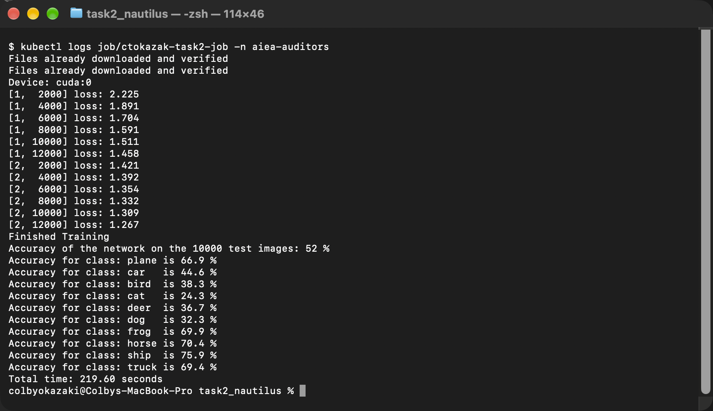

**Task 2: Nautilus** · Colby Okazaki · Repository: <https://github.com/ctokazak/aiea-cmpm118> (folder `task2_nautilus/`)

## Summary

**What Nautilus is.** Nautilus is the National Research Platform's shared Kubernetes cluster: GPU machines at many universities pooled into one system. Instead of logging in to a machine, you write a YAML file saying what you need (image, CPUs, memory, GPUs, storage), and Kubernetes runs it wherever there's room. Each group works in a **namespace**; ours is `aiea-auditors`. A **PVC** is storage that outlives any one pod. A **Deployment** keeps a pod running until you delete it, which is good for interactive work. A **Job** runs a command to completion and then frees its resources, which is better for training.

**What I did.**

- Logged in at nrp.ai through CILogon, set up `kubectl` with `kubelogin`, and was added to `aiea-auditors` on Nov 24.
- **JupyterHub:** ran `cifar10_tutorial.ipynb` on a server with a Tesla V100: 53% test accuracy in 21m44s.
- **PVC:** created `ctokazak-task2` (5Gi, `rook-cephfs`).
- **Deployment:** ran `ctokazak-task2-deploy` with the PVC at `/data` and 1 GPU. I copied `cifar10train.py` in with `kubectl cp` and trained with `kubectl exec`. It got an NVIDIA TITAN Xp, printed `Device: cuda:0`, and reached 55%. Then I deleted the Deployment.
- **Job:** ran `ctokazak-task2-job` on the same PVC, with `command` changed to run the training script. It finished in 4m23s at 52% (`Device: cuda:0`, screenshot on page 2). Then I deleted the Job.

## What went well

- Once I had access, the YAML files worked on the first try; the pod got a GPU in under a minute.
- Keeping the dataset on the PVC paid off: the Job reused it and finished in about 4 minutes instead of 30+.

## Issues I ran into

- `kubectl get pods -n aiea-auditors` returned **Forbidden** until I was added to the namespace.
- The kubeconfig from nrp.ai needs the separate `kubelogin` plugin; without it, the error doesn't say what's missing.
- Downloading CIFAR-10 inside the cluster was slow (~95–150 KB/s): 30 minutes in the Deployment, 19 on JupyterHub.
- The tutorial notebook never moves the model to the GPU (`net.to(device)` appears only in a text cell), so the JupyterHub run trained on the CPU despite the V100. My `cifar10train.py` does use `cuda:0`.

## Feedback and suggestions

- Mention `kubelogin` in the setup steps, and that "Forbidden" means you still need to be added to the namespace.
- Keep a shared copy of CIFAR-10 on a PVC in the namespace so each auditor doesn't download it again.
- Add `net.to(device)` to the tutorial notebook's training cells so it uses the GPU.

**Screenshot: Job training log** (`kubectl logs job/ctokazak-task2-job -n aiea-auditors`), showing `Device: cuda:0`

{width=6.5in}
